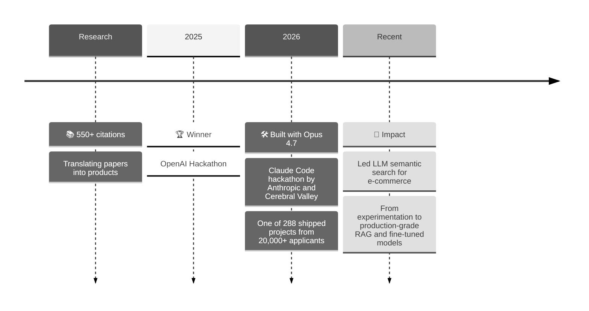

# Hojjat

**Senior ML Scientist**

  &nbsp;**PhD in Artificial Intelligence** 

Generative AI · Retrieval · Recommendation · Optimization

 

  

 OpenAI &nbsp;·&nbsp;
 Anthropic &nbsp;·&nbsp;
 Cerebral Valley

 

**Abstract —** Senior ML Scientist with **7+ years** of experience building and deploying production ML systems across generative AI, retrieval, recommendation, and optimization. Most recently focused on **LLM-powered semantic search for e-commerce**, covering fine-tuning, evaluation, and cost-efficient deployment of customer-facing models, with hands-on experience translating research into reliable ML products and driving technical decisions from experimentation through production. The objective throughout: *turning "AI hype" into robust, reliable ML products that drive revenue.*

Work spans **generative AI** (LLM fine-tuning with SFT and LoRA/QLoRA, synthetic data, multi-agent RAG), **inference & ops** (vLLM, TensorRT, quantization, SageMaker/Bedrock), and **engineering** (PyTorch, DeepSpeed, Hugging Face, distributed training). Conversations about applied ML, research collaborations, and new opportunities are always welcome.

**Keywords —** Foundation Models · Problem Solving · Communication
